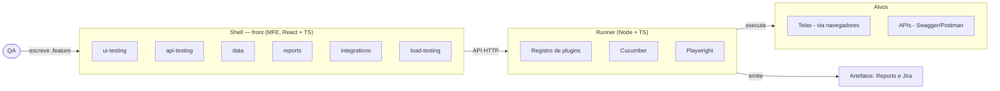

# QAStage

> Plataforma de testes de QA: o QA escreve arquivos `.feature` e testa telas e APIs a partir deles. Extensível por plugins.

**Status:** roadmap F0–F5 entregue, com múltiplos projetos e dashboard — `ui-testing`, `api-testing`, `load-testing` (k6), `reports` e `integrations` (Jira), cada um com painel no shell. Detalhes no [STATUS](STATUS.md).

---

## Começando

Pré-requisitos: Node ≥ 20, pnpm (via Corepack), **PostgreSQL** (15+) e, para carga, o k6 (`brew install k6`).

```bash
corepack enable && pnpm install
createdb qastage && createdb qastage_test   # ou DATABASE_URL no .env
pnpm db:migrate                          # cria as tabelas (knex)
pnpm db:seed                             # opcional (dev): admin@qastage.local e qa@qastage.local, senha qastage123
pnpm run ui-demo                         # site de demo        :4173
pnpm run api-demo                        # API de demo         :4280 (2 bugs plantados)
pnpm --filter @qastage/runner dev        # runner (API HTTP)   :4000
pnpm --filter @qastage/shell dev         # shell               :5173  → dashboard de projetos
pnpm --filter @qastage/plugin-ui dev     # painéis (remotes): telas :5174, relatórios :5175,
pnpm --filter @qastage/reports dev       #   APIs :5176, carga :5177
pnpm --filter @qastage/plugin-api dev
pnpm --filter @qastage/plugin-load dev
# com o pnpm no PATH, `pnpm dev` sobe runner, shell e painéis de uma vez (turbo)
```

Abra http://localhost:5173. No primeiro acesso o shell pede para criar o **administrador**; ele cadastra os
QAs e libera os projetos de cada um (ver "Usuários e permissões"). Pela CLI:

```bash
pnpm run runner -- projects                                                     # lista os projetos
pnpm run runner -- run ui-testing   --project portal-demo  --feature features/ui/login.feature
pnpm run runner -- run api-testing  --project api-clientes --feature features/api/clientes.feature
pnpm run runner -- run load-testing --project api-clientes --feature features/carga/carga.feature
```

Toda execução grava `artifacts/<projeto>/<plugin>/<id>/report.html` e, por falha, `falhas/NN-cenario/falha.md`.

Jira (opcional): copie [.env.example](.env.example) para `.env` e preencha. Para testar sem Jira real,
`pnpm run jira-fake` sobe um Jira de mentira na porta 4180.

---

## Projetos

Um QA testa vários sistemas no mesmo dia; cada sistema é um **projeto**. A tela inicial do shell é o dashboard
de projetos (ambientes, quantidade de cenários por tipo, últimas execuções); ao entrar, os painéis listam,
abrem, salvam e executam os `.feature` daquele projeto, e o histórico é só dele.

```
projetos/
  portal-clientes/
    qastage.config.json      # ambientes, regras e padrões (ver abaixo)
    features/
      ui/*.feature           # telas      → ui-testing
      api/*.feature          # APIs       → api-testing
      carga/*.feature        # carga (k6) → load-testing
    qastage/maps/            # mapas de tela do scan + exceptions.json
```

- **Novo projeto:** botão no dashboard (nome, URL do front, URL da API, Swagger) ou crie a pasta à mão.
- **Projeto em outro repositório** (os `.feature` junto do código do sistema): liste o caminho em
  `qastage.projects.json` na raiz do QAStage: `{ "projetos": ["../portal-clientes/qa"] }`.
- Caminhos relativos (Swagger, mapas, `.feature`) valem a partir da pasta do projeto; nada sai dela.
- Config inválida num projeto aparece no card dele, sem derrubar os outros.

## Visão e objetivos

Uma plataforma onde o QA escreve apenas arquivos `.feature` e testa tanto telas quanto APIs, para ganhar performance e padronizar os testes do time.

- **Entrada única:** o QA compõe cenários em Gherkin a partir de um vocabulário fixo de passos reutilizáveis — quase sem escrever código.
- **Duas frentes, uma base:** telas (via navegador) e endpoints (via Swagger/Postman) reusam os mesmos dados e a mesma estrutura.
- **Funciona em projeto legado:** nem todo projeto tem Swagger ou `data-testid`. O sistema degrada para mapeamento mais manual em vez de travar.
- **Princípio inegociável:** o QA nunca é bloqueado por falta de contrato (Swagger ausente, `data-testid` esquecido, auth incomum). Sempre há um caminho manual de saída.

## Princípios de design

Cinco regras orientam todas as decisões abaixo.

1. **Nunca bloquear o QA.** Todo caminho automatizado tem uma saída manual. Falta de `data-testid`, de Swagger ou de auth padrão nunca impede o QA de criar e rodar um teste.
2. **Zero LLM no caminho crítico.** Mapear endpoints (Swagger), resolver campos (`data-testid`) e gerar dados (geradores) é tudo determinístico. IA é opcional, cacheada e nunca necessária para rodar um teste.
3. **Tudo que varia por projeto é um adapter plugável.** Fonte de endpoints, autenticação, estratégia de localização e navegadores são configuração, não código novo.
4. **O `.feature` é a porta de entrada.** O QA compõe a partir de um vocabulário fechado de passos; cada módulo contribui com o seu.
5. **Extensibilidade por plugins.** Um novo tipo de teste entra como um plugin, sem reescrever o núcleo.

## Arquitetura macro

O QA autora no front (MFE); o Runner (Node) executa com Cucumber + Playwright e devolve o resultado. O front nunca roda Playwright. Os artefatos de cada execução alimentam o relatório e a integração com o Jira.



## Contrato de plugin

Cada tipo de teste é um plugin, e todo plugin contribui em **duas metades ao mesmo tempo** — é isso que torna o sistema realmente plugável, e não só visual.

- **Metade do front (micro-frontend):** o painel onde o QA escolhe telas/endpoints, escreve o `.feature` daquele tipo e vê o relatório. É um *remote* federado no shell.
- **Metade do runner (pacote Node/TS):** a biblioteca de passos Gherkin daquele tipo + os hooks de execução.

Adicionar um módulo = **um micro-frontend novo** (federado no shell) **+ um pacote de passos novo** (registrado no runner). O manifesto do plugin declara o nome, o remote do front e o ponto de registro no back.

**Nem todo plugin usa Cucumber.** O contrato modela um *executor*, não "passos de Cucumber": uns plugins fornecem passos Gherkin (ui, api), outros trazem o próprio motor — o plugin de carga roda o k6, que tem runtime próprio. Cucumber é um executor entre outros.

## Mapa de módulos

Cada módulo (exceto o core) é um plugin com as duas metades descritas acima.

| Módulo | Responsabilidade |
| --- | --- |
| core / shell | Host do micro-frontend, navegação, seleção de ambiente, auth do próprio sistema e o contrato de plugin. |
| ui-testing | Telas: scan de `data-testid`, mapa por tela com fallback do QA, passos de tela. |
| api-testing | APIs: ingestão de Swagger/Postman, geração de corpo, validação de schema, testes negativos. |
| load-testing | Carga com k6: gera o script a partir dos endpoints e dados, roda o k6 e envia as métricas ao reports. Só em ambiente autorizado. |
| data | Fixtures + geradores BR válidos; preenchimento automático por nome de campo + override. |
| reports & artifacts | Prints de sucesso/falha, relatório navegável, armazenamento de artefatos. |
| integrations | Jira (card na falha) e, no futuro, Slack e outros. |

## Usuários e permissões

Dois papéis. O **admin** vê todos os projetos, cria projetos e cadastra pessoas; o **QA** só vê os projetos
que o admin atribuiu a ele — no dashboard e em toda a API.

- **Primeiro acesso:** sem nenhum usuário, o shell oferece criar o administrador (ou, na máquina do runner:
  `pnpm run runner -- usuarios admin <email> <nome>`).
- **Administração** (menu do usuário → Administração): criar pessoa (gera **senha temporária**, mostrada uma
  vez), trocar papel, marcar os projetos de cada QA, redefinir senha, desativar.
- Cada um troca a própria senha no menu do usuário. Desativar, mudar o papel ou redefinir a senha encerra as
  sessões abertas daquela pessoa.

Como é protegido:

- A regra vale **no runner**, não só na tela: projetos, `.feature`, execuções, histórico, relatórios e prints
  de projeto não atribuído respondem 403.
- Senhas com **scrypt** + sal no Postgres; a API nunca devolve o hash.
- Sessão em cookie **HttpOnly** (12 h); o banco guarda só o **hash** do token (um dump não dá sessões utilizáveis), CORS restrito às origens do shell (`QASTAGE_ALLOWED_ORIGINS`) e
  escrita só com JSON (formulário de outro site não consegue disparar ações).
- 5 senhas erradas seguidas bloqueiam aquele login por 1 minuto; a mensagem de erro não revela se o e-mail existe.
- Sempre resta ao menos um administrador ativo.
- O relatório e o histórico registram **quem executou**; a tabela `auditoria` guarda logins, gestão de usuários,
  criação de projetos, arquivos salvos e execuções.
- A **CLI** é ferramenta do operador da máquina do runner e não passa por login (quem tem acesso ao disco já tem os arquivos).
  Comandos: `usuarios listar | admin <email> <nome> | senha <email>`.

## Banco de dados e API

O runner é uma API **Fastify** sobre **PostgreSQL** (via **Knex**). No banco ficam usuários, atribuições de
projeto, sessões, o histórico de execuções (resumo, contagens, falhas, card do Jira) e a auditoria. Continuam
em arquivo o que precisa estar no git (config e `.feature` dos projetos) e os artefatos pesados (prints,
traces, `report.html`), que o histórico referencia.

| Comando | O que faz |
| --- | --- |
| `pnpm db:migrate` | aplica as migrations (`apps/runner/db/migrations`) |
| `pnpm db:rollback` | desfaz o último lote |
| `pnpm db:status` | migrations aplicadas e pendentes |
| `pnpm db:seed` | usuários de desenvolvimento (idempotente; recusa rodar em produção) |
| `pnpm --filter @qastage/runner db:make <nome>` | nova migration |
| `pnpm run runner -- historico importar` | traz para o banco os `report.json` antigos (idempotente) |
| `pnpm --filter @qastage/runner test` | testes da API inteira contra o banco `qastage_test` |

- Configuração em [`apps/runner/knexfile.ts`](apps/runner/knexfile.ts) (`DATABASE_URL`, ambientes development/test/production).
- O runner não sobe com migration pendente (mensagem diz o comando) e, ao subir, marca como interrompidas as
  execuções que estavam rodando quando ele caiu.
- Rotas em `apps/runner/src/http/rotas/`, com schema de validação nos corpos (campo desconhecido é recusado).

## Configuração do projeto (`qastage.config.json`)

Cada projeto tem um `qastage.config.json` na sua pasta, versionado junto com os `.feature`. Ele substitui
URLs digitadas em cada painel e regras fixas no código: o QA escolhe só o ambiente.

```json
{
  "projeto": "Portal Clientes",
  "padrao": "qa",
  "ambientes": {
    "qa":      { "front": "https://qa.portal.com",      "api": "https://api-qa.portal.com",  "escrita": true },
    "homolog": { "front": "https://homolog.portal.com", "api": "https://api-hml.portal.com", "escrita": false, "carga": true }
  },
  "plugins": {
    "ui-testing":   { "maps": "qastage/maps", "browser": "chromium" },
    "api-testing":  { "spec": "https://api-qa.portal.com/openapi.json" },
    "load-testing": { "spec": "https://api-qa.portal.com/openapi.json" }
  }
}
```

| Campo | Significado |
| --- | --- |
| `ambientes.<nome>.front` / `api` | URL das telas e da API (a `api` cai na `front` se omitida) |
| `escrita` | Aceita POST/PUT/PATCH/DELETE. **Padrão `false`**: criar registro em ambiente compartilhado é explícito |
| `carga` | Autorizado para teste de carga. **Padrão `false`** |
| `plugins.<plugin>` | Parâmetros padrão do plugin (os mesmos de `--<param>` na CLI); o pedido de execução sobrescreve |

- O runner lê o arquivo a cada execução (editar vale na hora) e valida com mensagens claras.
- CLI: `--env qa` basta; `--url` e `--apiUrl` sobrescrevem as URLs pontualmente.
- Shell: lista os ambientes do arquivo (iguais para o time todo) e mostra "escrita"/"só leitura"/"carga".
- Segredos **não** vão aqui: ficam no `.env` (ver `.env.example`).
- Sem projeto (CLI sem `--project`), vale um `qastage.config.json` na raiz do QAStage, se houver; sem nenhum,
  o modo antigo (URL pela CLI, homolog só leitura).

## Adapters por projeto

O que varia de um projeto para outro não entra como código novo, e sim como um adapter configurado por projeto. São quatro eixos.

| Eixo | Opções | Fallback para legado |
| --- | --- | --- |
| Fonte de endpoints | OpenAPI/Swagger, Postman collection, Insomnia, HAR | Importa a collection antiga que o time já usava |
| Autenticação | Bearer via login, API key, OAuth2, SSO | SSO: captura a sessão autenticada uma vez (`storageState` do Playwright) e reusa |
| Localização de elemento | `data-testid`, semântico (role/label/placeholder), manual | Mapa manual editado pelo QA quando não há testid |
| Navegadores | Chromium, Firefox, WebKit | Matriz por projeto, para sistemas antigos que exigem mais de um |

- **Nem todo projeto tem Swagger.** Por isso a fonte de endpoints é um adapter: um projeto aponta o link do Swagger, outro sobe uma collection do Postman. O resto do pipeline é o mesmo.
- **SSO existe.** A autenticação é uma estratégia plugável. Para SSO, o fluxo interativo roda uma vez e a sessão fica salva; os testes reusam sem passar pelo IdP a cada execução.

## Testes de tela (UI)

O QA escreve rótulos humanos; o runner resolve o elemento sem gastar tokens. A resolução segue uma cadeia, parando no primeiro acerto.

1. **`data-testid`** derivado do slug do rótulo ("Finalizar pedido" → `finalizar-pedido`).
2. **Semântico:** `getByRole`, `getByLabel`, `getByPlaceholder`, `getByText`. Cobre telas acessíveis sem testid.
3. **Fallback manual do QA:** quando o front esqueceu o testid, o QA informa outro identificador (atributo, css, texto). Vira uma entrada no mapa de exceções.

**Scan e mapa.** Um crawler lê o DOM de cada tela, encontra os `data-testid` e grava um mapa por tela. Os testes rodam pelo mapa; ele só é regerado quando a tela muda.

**Convenção com o dev:** o `data-testid` é o slug do rótulo visível. Assim o QA escreve o rótulo natural e o dev nomeia o testid igual, sem tabela de-para.

## Testes de API

O QA carrega a fonte (link do Swagger ou collection do Postman) e o sistema mapeia todos os endpoints — sem LLM. O parser extrai caminhos, métodos, parâmetros, schema do corpo, schema da resposta e esquema de auth.

Com isso o sistema, de forma determinística:

- **Gera um corpo estruturalmente válido** a partir do schema (`required`/`enum` respeitados).
- **Valida a resposta contra o schema** do endpoint (via ajv) — pega quebra de contrato de graça.
- **Monta testes negativos quase sem esforço:** tirar um campo obrigatório ou mandar tipo errado e exigir `4xx`.

**Swagger só com tipos.** Como os Swagger costumam vir só com a definição de tipo (`{ nome: string }`), sem exemplos, a estrutura sai do schema e o **valor** válido sai do módulo de dados por nome de campo. A sequência entre endpoints o QA descreve no `.feature`; o token vem do adapter de auth.

## Dados e fixtures

O dado segue um fluxo em três passos, sem LLM: o schema dá a forma, o provedor preenche por nome de campo, o QA sobrescreve o que for específico.

- **Preenchimento automático por nome de campo.** O schema diz que existe um campo `cpf`; um provedor resolve `cpf` para um CPF válido.
- **Override por fixture.** Quando o caso exige um dado específico, o QA aponta uma fixture nomeada.
- **Geradores BR válidos.** CPF, CNPJ e CEP são gerados já válidos. Dado em português válido sai de gerador determinístico, melhor que de IA.
- **Dados compartilhados entre UI e API.** A mesma fixture de cliente testa a tela e o endpoint.

## Relatórios, artefatos e Jira

Cada execução gera artefatos (prints, logs, HAR, vídeo) que alimentam documentação, relatório e integração.

- **Prints como documentação viva.** Captura em sucesso também, passo a passo.
- **Relatório de falha para o dev.** No erro, o runner emite um pacote estruturado (cenário, passo que falhou, print, logs, ambiente, dado usado).
- **Armazenamento de artefatos.** Filesystem no POC; object storage em produção.

**Integração Jira.** Um plugin `integrations/jira` cria ou atualiza o card na falha, com prints e documentação anexados. Dois cuidados obrigatórios:

- **Dedupe.** Chave por cenário + fingerprint da falha. Se já existe card aberto, comenta/atualiza em vez de abrir outro.
- **Assíncrono e opcional.** A integração nunca trava nem derruba a execução se o Jira estiver fora.

## Ambientes e cross-browser

A URL não fica escrita no `.feature`; vem da config de ambientes, para o mesmo cenário rodar em qualquer lugar.

- **Config de ambientes:** `dev`, `qa`, `homolog`, cada um com `baseUrl` e `authUrl`. O QA roda `--env qa` ou passa `--url http://localhost:3000` para o caso local.
- **Matriz de navegadores:** Chromium, Firefox e WebKit por projeto.
- **Ambiente seguro para escrita:** endpoints de escrita criam registros de verdade. O sistema marca quais ambientes aceitam escrita, para não sujar homolog sem querer.

## Estrutura do repositório

Um **monorepo único** com workspaces, front e runner juntos. O motivo decisivo é o contrato de plugin ter duas metades (front + back) — um plugin muda atômico num só PR, e os tipos compartilhados são `import`, não pacote publicado. Repo único não impede deploy independente: o Module Federation carrega cada remote em runtime.

```
qastage/
  apps/
    shell/          # host MFE (React + TS)
    runner/         # servico Node + TS (Cucumber/Playwright)
  packages/
    core-contract/  # manifesto de plugin + tipos compartilhados
    data/           # fixtures + geradores BR
    reports/
    plugin-ui/      # web/ (remote) + runner/ (passos)
    plugin-api/
    plugin-load/    # k6
```

Cada plugin é um pacote com as duas pontas dentro. Workspace: pnpm + Turborepo. Front: Module Federation via `@module-federation/vite`, com os remotes registrados em runtime a partir do manifesto de cada plugin.

## IA assistiva (versão futura)

Não implementado — registrado para uma versão futura. Hoje o QAStage não usa nenhuma IA, e isso é proposital
(princípio 2): achar campos, gerar corpo e validar contrato é tudo determinístico, sem custo por execução e
com o mesmo resultado sempre.

**Como entraria:** um módulo `ai` como **adapter opcional por projeto**, igual ao Jira. IA desligada ou fora
do ar nunca impede um teste de rodar; o que ela sugere o QA confirma, e o resultado fica salvo para repetir igual.

| Uso | Onde | Saída |
| --- | --- | --- |
| Sugerir seletor quando um campo não resolve | Formulário de exceção (ui-testing) | Seletor proposto; o QA confirma e vira exceção no mapa |
| Rascunhar o `.feature` | A partir dos endpoints (api-testing) ou do mapa de uma tela | Rascunho no editor, para o QA revisar |
| Resumir a falha | Card do Jira (integrations) | Parágrafo em linguagem simples no topo do card |
| Valores de teste realistas | Campos que o módulo `data` não conhece | Valor gerado uma vez e salvo como fixture |

**Provedor:** a empresa usa hoje o **GitHub Copilot**. O Copilot não oferece uma API genérica para um sistema
terceiro chamar como assistente, então o caminho provável é o **GitHub Models** ou o **Azure OpenAI** — a
confirmar com a área de TI/segurança antes de implementar. O adapter teria a forma:

```
QASTAGE_AI_PROVIDER=github-models | azure-openai | openai | anthropic | ollama | none   # padrão: none
QASTAGE_AI_MODEL=...
QASTAGE_AI_KEY=...
```

**Cuidados a definir:** o que pode ser enviado ao provedor (HTML de tela e corpo de API podem ter dado
pessoal; segredos já são mascarados), custo por uso e cache das respostas.

## Roadmap por fases

Começa pelas telas, que é a prioridade do time. Cada fase entrega valor usável.

| Fase | Entrega | Gate para a próxima |
| --- | --- | --- |
| F0 | Contrato de plugin + esqueleto (shell MFE + runner com registro dinâmico de passos) | Um plugin de exemplo roda ponta a ponta |
| F1 | ui-testing: scan de `data-testid`, mapa com fallback, passos de tela | Um `.feature` roda contra uma URL e resolve campos |
| F2 | reports & artifacts: prints de sucesso/falha, relatório navegável | Falha gera pacote estruturado para o dev |
| F3 | integrations/jira: card automático na falha, com dedupe | Falha abre/atualiza card com anexos |
| F4 | api-testing: Swagger/Postman, schema, negativos | Endpoint validado contra o schema |
| F5 | load-testing: k6 a partir dos endpoints e dados | Carga roda em homolog autorizado, com thresholds |
| Futuro | ai (opcional): sugestão de seletor, rascunho de `.feature`, resumo de falha | Nenhum teste depende da IA para rodar |

## Decisões em aberto

- **IA assistiva:** provedor (GitHub Models / Azure OpenAI, alinhado ao Copilot da empresa) e política de dados — ver "IA assistiva (versão futura)".
- **SSO:** o fluxo exato varia por projeto (SAML/OIDC, MFA); cada projeto que usa SSO precisa de uma captura inicial de sessão.
